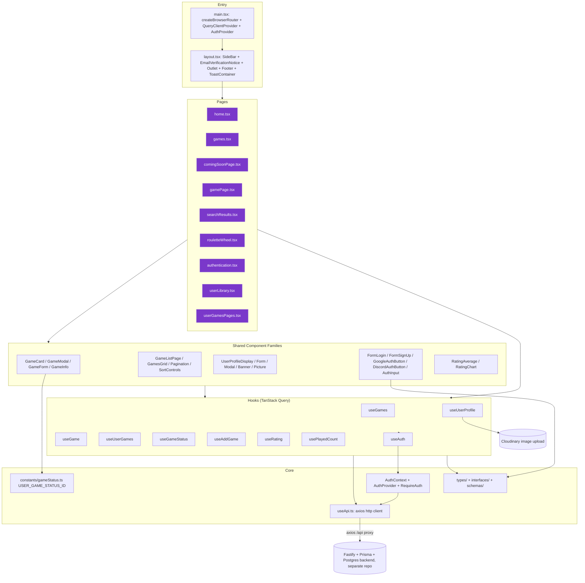
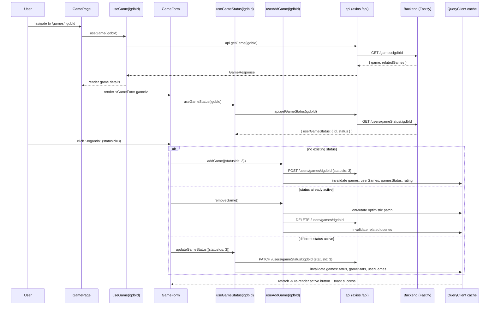

# Codebase Map

> Auto-generated by Cartographer. Last mapped: 2026-09-12T18:18:19Z

## System Overview

React 18 + Vite + TypeScript + TailwindCSS SPA for "Lib" — personal game-library tracker, IGDB-backed catalog + per-user status/rating/completion tracking. Backend: separate Fastify+Prisma+Postgres repo (`lib`), reached via `/api` (Vite dev proxy → `localhost:3333`). State: TanStack Query v5 for all server state, React Context only for auth. Styling: Tailwind, custom dark-theme tokens, `tailwind-merge` for conditional classes. Forms: `react-hook-form` + `zod`. Routing: `react-router-dom` v6 `createBrowserRouter`. No test files anywhere.



## Directory Structure

```
src/
  assets/                    static images
  components/                shared UI components (flat)
    gamesComponents/          GameCard/GameModal/GameForm/GameInfo/GamesGrid family
    userGamesComponents/      profile edit + platform import family
    libraryComponents/        library/profile page: header, status shelves, empty state
    homeComponents/           home page: cover wall, logged-out hero, playing now, next up, summary
  constants/                 USER_GAME_STATUS_ID
  contexts/auth/             AuthContext, AuthProvider, RequireAuth
  hooks/                     TanStack Query hooks + useApi (axios client)
  interfaces/                component prop types (games/ui/user)
  pages/                     one file per route
  schemas/                   zod schemas (login/signup/profile)
  types/                     domain types (games/user/rating/sidebar)
  utils/                     helpers; `platformConsoles.ts` mirrors the back end console × platform map; `releaseDate.ts` formats IGDB release dates in UTC (IGDB sends midnight UTC, local formatting shows the previous day in Brazil); `platformLabel.ts` shortens platform names (PC, PS5, Xbox Series...)
docs/                        this map
```

## Full Routing Map

All routes are children of one `<Layout/>` (persistent `SideBar` + `ToastContainer`, via `<Outlet/>`).

| Path | Component | File | Auth-gated? |
|---|---|---|---|
| `/auth` | `Authentication` | `pages/authentication.tsx` | No |
| `/verify-email` | `VerifyEmailPage` | `pages/verifyEmailPage.tsx` | No (works logged in or out; consumes `?token=`) |
| `/` | `Home` | `pages/home.tsx` | No (renders differently if logged in) |
| `/search/:query` | `SearchResults` | `pages/searchResults.tsx` | No |
| `/games` | `Games` | `pages/games.tsx` | No |
| `/games/comingSoon` | `ComingSoonPage` | `pages/comingSoonPage.tsx` | No |
| `/games/:igdbId` | `GamePage` | `pages/gamePage.tsx` | No (interactive parts hidden if logged out) |
| `/roulette` | `RouletteWheel` | `pages/rouletteWheel.tsx` | No (but needs `user.id` internally — see Gotchas) |
| `/termos` | `TermsPage` | `pages/termsPage.tsx` | No (linked from the footer "O projeto" column and from the sign-up checkbox label) |
| `/privacidade` | `PrivacyPage` | `pages/privacyPage.tsx` | No (same) |
| `/sobre` | `AboutPage` | `pages/aboutPage.tsx` | No (same) |
| `/contato` | `ContactPage` | `pages/contactPage.tsx` | No (same) |
| `/userLibrary` | `UserLibrary` | `pages/userLibrary.tsx` | **Yes** (`RequireAuth`) |
| `/userLibrary/:status` | `UserGamesPageByStatus` | `pages/userGamesPages.tsx` | **Yes** (`RequireAuth`) |

## Module Guide

### Game card / modal / form family (`src/components/gamesComponents/`)

Core reusable "show a game, let a user act on it" unit.

| File | Role |
|---|---|
| `gameCard.tsx` | Cover thumbnail, 6 sizes (`small`/`medium`/`compact`/`larger` plus `row` 44px and `feature` 92px, both 7:10 and without badges or hover overlay). Exports `GameCard` + `getGameTag()` helper (also used standalone by `dlcAndOriginalGameArea.tsx`). `CATEGORY_TAGS` (IGDB category id → PT label) + `TEXT_HINTS` (regex fallback via name/summary when category id missing). `interactive` prop toggles `<button>` (default) vs plain `<div>` — exists solely so callers who already wrap the card in a router `<Link>` don't nest a button inside an anchor. |
| `gameModal.tsx` | Radix `Dialog` wrapper for game popovers; visually-hidden title for a11y. |
| `gameForm.tsx` | Status button row (Jogado/Jogando/Backlog/Lista de Desejos), filtered by whether `game.releaseDate` is past. Toggling active status removes it; different status updates; no status adds. Renders `PlayedCount` only when status is PLAYED. |
| `../gamePlatformsSection.tsx` | Platform rows in the game modal. Row key is `platform:console`; PlayStation/Xbox/Nintendo/Steam ask for the console through `ConsolePicker` (native `<select>`, options filtered by the game's IGDB platforms via `consolesForGame`; a single remaining console is added without asking), Epic adds as `UNKNOWN`. "Outro" is no longer offered (old `OTHER` rows still display). Row name is the console, or the platform when the console is `UNKNOWN`. Shows a note when a platform has 2+ known consoles (imports skip those games). |
| `../userGamesComponents/completionSuggestions.tsx` | `CompletionSuggestionsBlock`: expandable list under the import summary in the Steam card of the "Importar jogos" modal (`fresh` toggle with amber dot, `last` outline button). Rows: cover/initials, hours vs time-to-beat, achievements, multiplayer warning (`lowConfidence`), "Marcar como Jogado" / "Ainda não terminei". Undo in the row and in a 10 s toast. `role="status"` region is always mounted. |
| `../userGamesComponents/hiddenImportRow.tsx` | Collapsed one-line row shown instead of the last import result when the user hid it (`Importação oculta · ● N para revisar · Mostrar`; count becomes a chip under 520 px). Count comes from the shared suggestions query. |
| `gameInfo.tsx` | Modal body: cover + name + `GameForm` + `RatingAverage` (or login prompt) + "Ver Detalhes"/"Cancelar". |
| `gamesGrid.tsx` | Grid wrapper, `GameCardData[]` → `GameCard` (`size="medium" enableModal`), falls back to `EmptyState`. |

Interconnection: `GameCard(enableModal=true)` owns local `open` state, lazily mounts `GameModal → GameInfo → (GameForm, RatingAverage)`. Every listing context that wraps `GameCard` in its own `<Link>` (home, search, similar games, game-list sections) passes `interactive={false}`.

### Auth flow

| File | Role |
|---|---|
| `contexts/auth/authContext.tsx` | `AuthContextType` (`user: Partial<User> \| null`, `loading`, `login`, `signup`, `logout`, `refreshUser`). |
| `contexts/auth/authProvider.tsx` | Hydrates `user` via `api.me()` on mount. Whole app tree gated behind `!loading`. `login`/`signup` call `api.me()` again after success, because those endpoints only return `{ id }` / `{ id, userName }` (no `email`, no `emailVerified`). `refreshUser()` re-fetches `/users/me` without touching `loading`, so it never unmounts the tree. |
| `contexts/auth/requireAuth.tsx` | Redirects to `/auth`, stashes `location.pathname` in `sessionStorage['redirectAfterLogin']`. |
| `hooks/useAuth.ts` | `useContext(AuthContext)`, throws outside provider. |
| `formLogin.tsx` / `formSignUp.tsx` | react-hook-form + zod; read/clear `redirectAfterLogin` on success; render Google/Discord OAuth buttons. Use `useContext(AuthContext)` directly rather than `useAuth()` (inconsistent, functionally equivalent). |
| `emailVerificationNotice.tsx` | Strip rendered by `layout.tsx` under the nav on every page, only when `user.emailVerified === false` (OAuth accounts come verified). "Reenviar" + dismiss; dismissal is stored per user id in `sessionStorage['emailNoticeDismissed']`, so it returns next session. |
| `pages/verifyEmailPage.tsx` | Reads `?token=` once and strips it from the URL. Does **not** verify on load: it shows a "Confirmar e-mail" button and calls `api.verifyEmail` only on click, so link scanners in mail clients can't burn the single-use token (reloading before the click loses the token; reopening the email link works). Centered layout, display-font title. States: ready, success, invalid (400 or no token); "já está confirmado" only after a 400 for a verified session. The success copy names the session's email only if that session went from unverified to verified, since the link may belong to another account. Non-400 errors keep the button and show `getErrorMessage`. Logged in: `refreshUser()` then library link, or "Reenviar link" on an invalid link. Logged out: link to `/auth?tab=login`. |
| `googleAuthButton.tsx` / `discordAuthButton.tsx` | Full-page redirects to backend OAuth endpoints. Without props they are a plain `<a href>` (Login). With `acceptedTerms` the link carries `?acceptedTerms=true`; with `disabled` they render a `<button type="button" aria-disabled>` that ignores clicks and points to the checkbox message through `aria-describedby`. Both are thin wrappers over `oauthButton.tsx`. |
| `useApi.ts` (`api.login/signup/logout/me`) | axios instance, `withCredentials: true`, 401 interceptor clears cookies on `session_expired`/`unauthorized`. |

### Custom hooks (`src/hooks/`)

| Hook | Purpose | Query keys | Notes |
|---|---|---|---|
| `useApi.ts` | Not a hook — exports `api` (axios wrapper), also called directly by `sideBar.tsx`/`rouletteWheel.tsx`, bypassing hook layer. | n/a | Sort-field mapping gotcha, see below. |
| `useGames.ts` | Catalog: paged, infinite (search), coming-soon, home-featured. | `['games',...]`, `['gamesInfinite',...]`, `['comingSoon',...]`, `['gamesFeatured']` | `keepPreviousData` on paging/sort. |
| `useGamePlatforms.ts` | Per-game platform rows (`platform` + `console`, one row per console). `addPlatform/updatePlatform/removePlatform` take `(platform, console, ...)` and hit `/users/platforms/:igdbId/:platform/:console`; the response replaces the cache. | `['gamePlatforms', userId, igdbId]` | `PUT` with a known console adopts an existing `UNKNOWN` row of the same platform (no new row). Console × platform map mirrors the back end in `utils/platformConsoles.ts`. |
| `useCompletionSuggestions.ts` | "Looks finished" suggestions per import platform (Steam only today). Query + accept/dismiss/undo; accepted rows are kept in local state because the back end drops the game from the list once it becomes Played, so Undo only lives while the screen is open. Accept/undo invalidate library, profile and per-game caches. | `['completionSuggestions', userId, platform]` | Invalidated by `refreshAfterImport`. 409 becomes an inline row message. |
| `useHiddenImportResult.ts` | Hides the last import result and the suggestions block until the next import finishes. Stores the import's `finishedAt` in `localStorage` (`importHidden:v1:{userId}:{platform}`) via `useSyncExternalStore`; falls back to memory when storage fails and notifies same-tab listeners itself (the `storage` event only reaches other tabs). | n/a | A new import changes `finishedAt`, so the result shows again. Browser-only, not synced. |
| `useGame.ts` | Single game + similar games. | `['game', igdbId]`, `['similarGames', igdbId]` | |
| `useGameStatus.ts` | Get/update one game's status. | `['gamesStatus', userId, igdbId]` | Invalidates `gameStats`, `userGames`. |
| `useAddGame.ts` | Add/remove from library. `removeGame` vs `removeUserGame` are near-duplicate mutations differing only in which cache they patch (`['games']` vs `['userGames', userId]`). | invalidates `games`, `userGames`, `gamesStatus`, `rating` | Optimistic + rollback. |
| `useRating.ts` | User rating, community average, distribution. | `['rating', userId, igdbId]`, average key embeds the rating value itself, `['ratings', igdbId]` | Optimistic + rollback. |
| `usePlayedCount.ts` | "Times completed" counter, enabled only when status id === 1 (hardcoded literal, not `USER_GAME_STATUS_ID.PLAYED`). | `['gameStats', userId, igdbId]` | Clamped min 1. |
| `useUserGames.ts` | Library grouped by status + totals + one recommended game. | `['userGames', userId, ...]`, `['games', userId]` | Key-prefix overlaps `useGames`'s `['games', ...]`, distinguished only by arg shape. |
| `useUserProfile.ts` | Profile fetch/update incl. Cloudinary upload. | `['userProfile', userId]` | Two-phase mutation: upload file(s), then submit URL string. |
| `useResendVerification.ts` | `{ resend, isSending, secondsLeft, waitLabel }` for `POST /auth/resend-verification`. Success toast + 60 s cooldown; a 429 starts a cooldown from `retry-after`; errors go through `getErrorMessage`. | n/a | The in-flight flag is module-level and the cooldown lives in `sessionStorage['emailVerificationResendCooldown']` as `{ userId, availableAt }`; a window event keeps the notice and the page in sync, so two buttons never send twice. |
| `usePrefersReducedMotion.ts` | `matchMedia('(prefers-reduced-motion: reduce)').matches`, read once per render — not reactive to live OS changes. | n/a | Feeds embla-carousel autoplay config. |

### Design tokens (`tailwind.config.js`)

```js
colors: {
  primary: { DEFAULT: '#7A38CA', light: '#9D52E8', hover: '#8B47DB', 'hover-light': '#AE63F9' },
  dark: { bg: '#1A1C26', 'bg-light': '#1F2029', 'bg-lighter': '#25262F', 'bg-darker': '#0F1117', card: '#181920', border: '#2A2B36' }
}
```

Convention: components use `bg-dark-bg*`, `border-dark-border`, `text-primary(-light)`, `bg-primary`, `hover:bg-primary-hover` — no hardcoded hex in `className`, except where third-party libs need literal color values (MUI `Rating` `sx` in `ratingAverage.tsx`, Recharts `Cell fill` in `ratingChart.tsx`) and in `rouletteWheel.tsx` (least-polished page, ad-hoc hex + placeholder text — known, deliberately unfinished per project owner).

### Everything else

| File | Purpose |
|---|---|
| `authInput.tsx` | Password-visibility-toggling input, `forwardRef` for RHF. |
| `button.tsx` | Variant/size system (primary/secondary/ghost/danger; secondary is the outlined style, danger is `red-700` for destructive confirms), loading spinner, `max-sm:min-h-11` touch height. |
| `iconButton.tsx` | The only icon-button component: `size` sm (28px) / md (36px), `tone` neutral/danger, `variant` filled/bare; a `before:` pseudo-element extends the touch area to 44px. |
| `categoriesDiv.tsx` | Pill chip — named for IGDB "category" but `gamePage.tsx` actually feeds it genre strings. |
| `details.tsx` | Genres/developers/publishers chips on game page. |
| `dlcAndOriginalGameArea.tsx` | Parent-game link + paginated DLC list, reuses `getGameTag`. |
| `emptyState.tsx` | Generic empty-state message. |
| `gameLaunchersDiv.tsx` | Per-platform release-date pill. |
| `gameListPage.tsx` | Composes `SortControls`+`GamesGrid`+`Pagination`; manages URL query params via manual `URL`/`history.pushState` (not `useSearchParams`, unlike `authentication.tsx`). |
| `gameListSection.tsx` | Home page's 3 list sections: from `lg` one `FeaturedGameRow` (first game) plus `GameRow`s (numbered for trending/rated), horizontal `CoverRow` below. `RatedScore` (in `homeComponents/gameListRows.tsx`) calls `useRating` per game (N+1 pattern). Release dates and platform labels come from `utils/releaseDate.ts` and `utils/platformLabel.ts`. |
| `footer.tsx` | Site footer rendered by `layout.tsx` on every page; account links depend on login state. |
| `homeComponents/` | Home blocks: `coverWall` (CSS-animated cover rows, logged out), `loggedOutHero`, `playingNow`, `nextUp` (backlog suggestion + queue), `librarySummary`, `coverRow` (horizontal cover strip), `styles` (shared title/link classes). |
| `iconButton.tsx` | Icon-only button base for pagination. |
| `pagination.tsx` | First/prev/next/last + "showing X of Y". |
| `platformDiv.tsx` | Platform pill, heuristic console-vs-PC icon by name substring. |
| `playedCount.tsx` | +/- "times completed" widget. |
| `playersInfo.tsx` | Per-status user counts + ratings count. |
| `ratingAverage.tsx` | Dual-layer MUI `Rating` (readonly + interactive hover) + remove button. |
| `ratingChart.tsx` | Recharts bar chart, rating distribution. |
| `searchBar.tsx` | Route-synced search input (`/search/:query`), autofocus + cursor-to-end. |
| `sectionHeading.tsx` | Reusable heading, colored dot + optional icon. |
| `sideBar.tsx` | Desktop nav + mobile drawer; calls `api.logout()` directly rather than via `useAuth()`. |
| `similarGamesSlider.tsx` | Embla carousel of similar games. |
| `sorting.tsx` | Sort field/order + optional status filter (user-library only). |
| `libraryComponents/profileHeader.tsx` | Shared profile header for `/userLibrary` and the public profile: optional low banner, picture, name, facts line (followers/following open modals), `actions` slot. No banner strip when `bannerUrl` is empty. |
| `libraryComponents/libraryShelves.tsx` | The four status shelves in fixed order (Zerados, Jogando, Pendentes, Lista de desejos; PAUSED has none). Owns copy, 3/8 caps (8 shown only from `2xl`), "Ver todos" links and empty-state links. `readOnly` for other users' profiles. |
| `libraryComponents/statusShelf.tsx` | One shelf: header + covers. Covers only, no text under them; `featured` (Jogando) = larger covers. Empty shelf collapses to one line with the link inline after the text. Mobile is a snap row, `lg` a 6-column grid. |
| `libraryComponents/emptyLibrary.tsx` | Whole-library empty state: import vs. add one by one. |
| `libraryComponents/importGamesModal.tsx` | "Importar jogos" dialog reusing the Steam/PSN/Xbox import sections — the only place imports live now (removed from the edit-profile form). |
| `userProfileDisplay.tsx` | Fetches own profile/followers, renders `ProfileHeader` + edit/followers/following modals. Optional `onImport` adds the "Importar jogos" action. |
| `userProfileForm.tsx` | Profile-edit form, banner/avatar upload w/ preview, dirty-tracking. |
| `userProfileModal.tsx` | Radix Dialog w/ **visible** title (contrast with `gameModal.tsx`'s hidden title). `title`/`description` props let `importGamesModal` reuse it. |

## Data Flow — Viewing a Game and Marking Status



## Conventions

- Zod schemas paired 1:1 with react-hook-form via `zodResolver`; form types via `z.infer<typeof schema>`.
- TanStack Query hooks named `use<Noun>`, expose `.mutateAsync` wrapped in plain functions rather than the raw mutation object.
- No hardcoded hex in Tailwind `className` outside third-party libs needing literal colors (MUI, Recharts) and the known-unfinished `rouletteWheel.tsx`.
- `focus-visible:outline focus-visible:outline-2 focus-visible:outline-offset-2 focus-visible:outline-primary-light` on every interactive element.
- `rounded-full` pill badges for small metadata chips; small square dot (`size-1.5 bg-primary`) as section-heading marker.

## Gotchas

1. **CRLF/LF mix** across ~10 files (schemas, auth context, a few pages/components) — noisy diffs, no functional impact.
2. **`interactive` prop on `GameCard`** — prevents `<button>` nested in `<a>`; always paired with `interactive={false}` where the caller wraps the card in a `Link`.
3. **Sort-field name mismatch**: `/users/userGames` backend expects `gameName`/`dateRelease`; only `useApi.getUserGames` maps this via `USER_GAMES_SORT_BY_MAP`. `getGames`/`getComingSoon` pass sort fields through unmapped — different backend routes use different naming conventions.
4. **Two independent status vocabularies**: `GameStatusEnum` (string, order Played/Playing/Paused/Backlog/Wishlist) vs `USER_GAME_STATUS_ID` (numeric, PLAYED:1/PAUSED:2/PLAYING:3/BACKLOG:4/WISHLIST:5 — different internal order). No compile-time link; kept in sync only by matching English key names. `usePlayedCount.ts` hardcodes numeric literal `1` instead of `USER_GAME_STATUS_ID.PLAYED`.
5. **`CategoriesDiv`/`categoryName`** used for genres in `gamePage.tsx` despite the name implying IGDB category (DLC/expansion/etc.) — real category-id classification lives in `gameCard.tsx`'s `getGameTag()`.
6. **`removeGame` vs `removeUserGame`** (`useAddGame.ts`) — near-duplicate mutations, differ only in which cache they optimistically patch. Candidate for consolidation.
7. **`/roulette` not wrapped in `RequireAuth`** despite needing `user.id` internally — shows empty state instead of redirecting when logged out.
8. **`/forgotPasswordPage` link in `formLogin.tsx`** has no matching route — intentional placeholder for a not-yet-built feature (per project owner), not a bug to fix.
9. **Unused dependencies**: `@auth0/auth0-react`, `typescript-cookie` in `package.json`, no imports found in `src/`. ESLint devDependencies present but Biome is the active linter (no `.eslintrc*`).
10. **`usePrefersReducedMotion`** reads `matchMedia` once per render, not reactive to live OS setting changes.
11. **`types/sidebar.ts`'s `MenuItem`** and `interfaces/ui.ts`'s `SideBarItemProps` are leftover types from a `SideBarItem` component that no longer exists (removed as dead code in a prior cleanup) — latent dead types, not caught by file-level orphan scans since the type files themselves are still imported elsewhere.
12. **Local variable names shadow their own type names** in destructured `useQuery` results (e.g. `const { data: GameResponse } = useQuery(...)`) across several hooks — stylistic, not a bug.
13. **`index.html`'s `<body class="bg-dark-bg-lighter">`** vs `Layout`'s root div `bg-dark-bg` — redundant double background declaration, harmless (Layout's div covers the body).

## Non-obvious behaviour

Reasons that used to live in code comments (the project keeps source files comment-free; lint directives such as `biome-ignore`, `eslint-disable` and `@ts-expect-error` stay in place).

**Lists and library**
- `components/gameListPage.tsx`: an empty list with a total above zero is not a real empty state. It is a page past the total, or the previous response kept by `keepPreviousData` while the right page loads. Both show the skeleton, not the empty state.
- `components/libraryComponents/libraryShelves.tsx`: on a public profile each status list arrives cut, so the per-mark count (Agora / Sempre jogando) is only reliable when every in-progress game came (`totalOf('PLAYING') <= games.PLAYING.length`).
- `components/gamesComponents/libraryStats.tsx`: `MAX_PLATFORMS_IN_MODAL` caps the per-platform detail in the modal; above it the detail lives only on the game page.
- `components/gamesComponents/gameCard.tsx`: top-rated lists carry the community average (for example 3.6969…), while the user's own rating is an integer.
- `interfaces/games.ts` (`interactive`): false when the caller already wraps the card in a `<Link>` or another clickable element, to avoid a `<button>` inside an `<a>`.

**Status, completions and the modal**
- `components/gamesComponents/gameStatusButtons.tsx`: with 2+ platforms the app asks first, because changing the status reloads the library and closes the modal, and the question would disappear with it. On the pick, the status is saved first and the +1 completion on the chosen row after it, so a failed status writes nothing and a retry (another row, or after Cancelar) never double counts or lands on the wrong row. If the platform write fails the game is already Jogado and the picker stays open; `completionPending` makes a later click on Jogado reopen the picker instead of the removal dialog until the write succeeds or "Só marcar" is used; the retry skips the status PATCH when the game is already Jogado (no second toast). The Jogado button stays disabled while the platforms query loads or has failed, so the picker cannot be skipped by a click before the list arrives. `useGamePlatforms.onChanged` also invalidates `gamePlatforms` so a refetch started by the status save cannot leave a stale count. This relies on the back end leaving completions alone for 2+ platforms (`markSinglePlatformCompleted` returns unless there is exactly one).
- `constants/gameStatus.ts` (`REVIEW_STATUS_LABEL`): only the statuses that allow a review have a label on the card.
- `hooks/useReviewPermission.ts`: someone who already has a review can edit it in any situation; the rule only applies to creating. A game in the backlog counts as played when there are hours or completions recorded (history of people who replay).
- `components/reviewRequirement.tsx` (`variant`): `link` points to the status buttons of the page itself; `picker` chooses the status right there.
- `components/reviewEditor.tsx` (`locked`): the field stays visible and disabled (no focus, no cursor) and `describedBy` points to the text with the reason.
- `utils/endlessAvailability.ts`: in Jogando, Pausado and Largado the flag is editable. In Jogado the control shows locked, because the flag may have stayed on from before. In Na fila, Lista de desejos and unreleased games it makes no sense, so the control does not show.
- `components/endlessToggle.tsx` and `components/gamesComponents/endlessChip.tsx` (`disabledReason`): when present, the control is inactive and the reason replaces the description (toggle) or appears beside it (chip).
- `components/ownReviewCard.tsx`: `Button` is a function component and does not forward `ref`, so the ref lives on a wrapper.

**Platforms and consoles**
- `utils/platformConsoles.ts` mirrors `CONSOLES_BY_PLATFORM` of the back end (`lib/src/utils/platform-consoles.ts`). The back validates again, so a value outside the map only yields a 400.
  - The back also accepts PC under XBOX (Game Pass on PC); the interface does not offer it: a PC game is registered under Steam, Epic or Outro > PC.
  - Epic has only PC: nothing to choose, so it enters as UNKNOWN (the back accepts it in any ecosystem). Steam asks between PC and Steam Deck.
  - The consoles list is the ones the game shipped on (plus backward-compatible successors); `null` means no platform data and does not filter. If the filter leaves no console of the ecosystem (incomplete IGDB data), it falls back to the whole list so the user is never left without an option.
  - Is there a console left to choose? An UNKNOWN row never coexists with known consoles (the back completes it when adding one), so it is enough to look at the consoles still without a row.
  - "Steam · PC" is redundant: PC on PC stores shows only the store name. Game Pass on PC shows "PC" with the Xbox icon, because "PC" alone would not say where it comes from.
- `utils/libraryPlatforms.tsx`: "Outro" stays in `LIBRARY_PLATFORMS` only to display old records; nothing new is added to it.

**Import**
- Hours per platform: `UserGamePlatformEntry.accountHours` (`{ gamertag, hoursPlayed }[]`, only XBOX rows have it) holds each linked account's contribution; `hoursPlayed` is their sum. With 2+ accounts, `AccountHoursLine` (modal in `libraryStats.tsx`) and the row hint in `gamePlatformsSection.tsx` list "gamertag + hours" as plain text; with one account nothing extra is shown. Editing hours by hand on an XBOX row is still allowed, but the next Xbox import overwrites it, and the editor says so.
- `hoursPlayed: null` means "no hours recorded yet", not zero (the Xbox did not report time, as on old Xbox 360 titles, or the platform was added by hand, or the field was cleared; the front cannot tell these apart): the modal and the platform row say "sem horas registradas", the field placeholder is "—", and `TotalsStrip` shows "—" under that label when every row is `null`. A real `0` still reads "0 h". `formatHours` writes pt-BR with one decimal ("62,5 h", non-breaking space), so parts can differ from the total by rounding. Profile totals, "Jogando agora" and review cards still use their own formats.
- Xbox allows up to 2 linked accounts (`User.xboxAccounts: { id, gamertag }[]`, back end `MAX_XBOX_ACCOUNTS`). `PlatformImportSection` takes optional `accounts`, `maxAccounts` and `getAccountResults`: with `maxAccounts > 1` it lists each account with its own "Desconectar" (`DELETE /users/xbox/:accountId`, confirmed in `ConfirmDialog`), shows "Adicionar outra conta" until the limit, and renders one result row per gamertag (a failed account shows its error only there; an account whose hours lookup failed shows the back end's `warning` in amber, also when there is a single account). Steam and PSN leave these props out and keep the single "Desconectar". `usePlatformImport`'s `disconnect` takes an optional account id. The `?xbox=limit` link result shows the limit message. Disconnecting removes that account's hours from the games (back end recomputes the sums).
- `components/userGamesComponents/platformImportSection.tsx`: the hidden-result block stays mounted when hidden, because the accepted rows and the "Desfazer" live in the block's state.
- `hooks/useCompletionSuggestions.ts`: the back removes the game from the list on accept. The accepted rows stay in local state so "Desfazer" stays visible while the screen is open.
- `components/userGamesComponents/hiddenImportRow.tsx`: classes are written out in full because Tailwind does not see names built by interpolation. Without a suggestions platform the hook only returns the Steam cache, so the count is ignored (`platform ? suggestions.pendingCount : 0`).
- `hooks/useHiddenImportResult.ts`: a hidden result only holds for the import whose end time was stored; a new import changes `finishedAt` and the result shows again. The `storage` event only reaches other tabs; the current tab is told by the listeners.

**Account deletion** (`components/userGamesComponents/deleteAccount{Section,Dialog}.tsx`, `hooks/useDeleteAccount.ts`)
- `components/confirmDialog.tsx` is shared by every destructive confirmation, the account dialog included (it passes the typed field as `children`, `confirmDisabled`, and swaps label/variant/handler for the 403). It focuses Cancelar on open (needed when `children` holds an input). Only with `lockWhileLoading` (the account dialog) it ignores close requests and disables Cancelar while `isLoading`; the others stay dismissable because the axios client has no timeout.
- The section sits after the form inside the edit-profile modal (outside the `<form>`, so its button never submits it). The dialog asks to type the username (read from the profile query, so a rename in the same modal is respected), or the e-mail when the account has no username; the comparison trims the typed text but is case-sensitive, and a failed attempt's error clears as soon as the text changes.
- The back end only accepts `DELETE /users` for a login of the last 10 minutes: older ones answer 403 `reauth_required` with a message, shown inside the dialog. Nothing is deleted and the request is not repeated after a new login.
- A 404 with a JSON `message` counts as success (the account is already gone; a bare proxy 404 does not), but a deleted account's cookies usually fail earlier with 401, because the back end revokes the sessions: that goes through the normal session-ended flow. The 401 interceptor is silenced (`setAccountDeletionInProgress`) from the moment the DELETE is sent, and the flag is cleared on a failed request, on login and on sign-up, so requests still in flight do not show "Sua sessão terminou" over "Sua conta foi excluída". Queries are cancelled, the app navigates to `/`, `clearSession()` empties the user and `queryClient.clear()` drops the cache. `api.logout()` is not used: it reloads the page.
- `/termos`, `/privacidade`, `/sobre` and `/contato` hold the owner's plain-language texts (no lawyer review; personal portfolio project), dated 2026-10-25. They are linked from the footer and from the sign-up checkbox label. The Terms say the user declares being 18+, and the sign-up form now has a required, unchecked-by-default checkbox for it (self-declaration, not age verification). If the texts change what the app really does (analytics, ads, private profiles), update them.
- Terms acceptance (`components/formSignUp.tsx`, `pages/authentication.tsx`): `acceptedTerms` lives in the sign-up form (`signUpSchema`, `z.boolean().refine`, because `z.literal(true, { message })` does not show its message in zod 3.23) and travels `AuthContext.signup` -> `api.signup` -> body of `POST /auth/register`. The 400 comes as `error.acceptedTerms[0]` (the top-level `message` is the generic "Invalid input"), read in `authProvider.signup`. The Google/Discord buttons stay disabled until the box is checked, then carry `?acceptedTerms=true`; the Login tab sends no parameter. A new account without acceptance makes the back end redirect to `/auth?error=terms_required`: the page keeps the notice in state, switches to the sign-up tab in the same `setSearchParams` call that removes `error`, and shows no toast. The notice sits in an `aria-live` region that is always mounted and does not move focus, because `useFocusOnRouteChange` focuses `main` 400 ms after the route loads on pages without an `h1`. The notice is cleared when the tab becomes Login (an effect, so browser back/forward also clears it), except in the render where the error has just arrived.

**Routing, scroll and errors**
- `layout.tsx` and `pages/gameReviewsPage.tsx`: the router keeps the scroll when changing page. A new page starts at the top; back/forward (POP) and anchor links (`#biblioteca`) are left as they are. Coming from "Ver todas" at the bottom of the game page, the reviews page goes to the top, but on browser back the restored scroll stays.
- `pages/userProfilePage.tsx`: the back end answers 400 for an id that is not a UUID and 404 for a UUID that does not exist; both show the not-found screen.
- `hooks/useApi.ts` (`getUserGames`): `/users/userGames` uses different names from the rest of the app (`gameName`/`dateRelease` instead of `name`/`releaseDate`); the mapping happens here so the inconsistency does not leak into the rest of the front.
- `utils/releaseDate.ts`: IGDB sends the release date as UTC midnight; formatting in the local time zone shows the previous day in Brazil.

## Navigation Guide

- **Add a new API endpoint**: add method to `hooks/useApi.ts` (`api` object) → wrap in a TanStack Query hook under `hooks/` → consume from a page/component.
- **Add a new page**: create under `src/pages/`, register route in `src/main.tsx`, wrap in `RequireAuth` if it needs a logged-in user.
- **Add a new component**: create under `src/components/` (or a `gamesComponents`/`userGamesComponents`/`libraryComponents` subfolder if it belongs to those families); use existing Tailwind color tokens (`primary`, `dark.*`), never hardcode hex; add `focus-visible` state if interactive.
- **Modify auth**: `contexts/auth/authContext.tsx` (shape) → `authProvider.tsx` (logic) → `requireAuth.tsx` (gating) → `hooks/useAuth.ts` (accessor).
- **Modify game status logic**: `constants/gameStatus.ts` (numeric ids) + `types/games.ts` (`GameStatusEnum`, string) — remember these are two separate vocabularies kept in sync by convention only (see Gotcha 4).
- **Add a new design token**: `tailwind.config.js` `theme.extend.colors` — reference the token elsewhere via `bg-<name>`/`text-<name>`/`border-<name>`, never inline the hex again.
